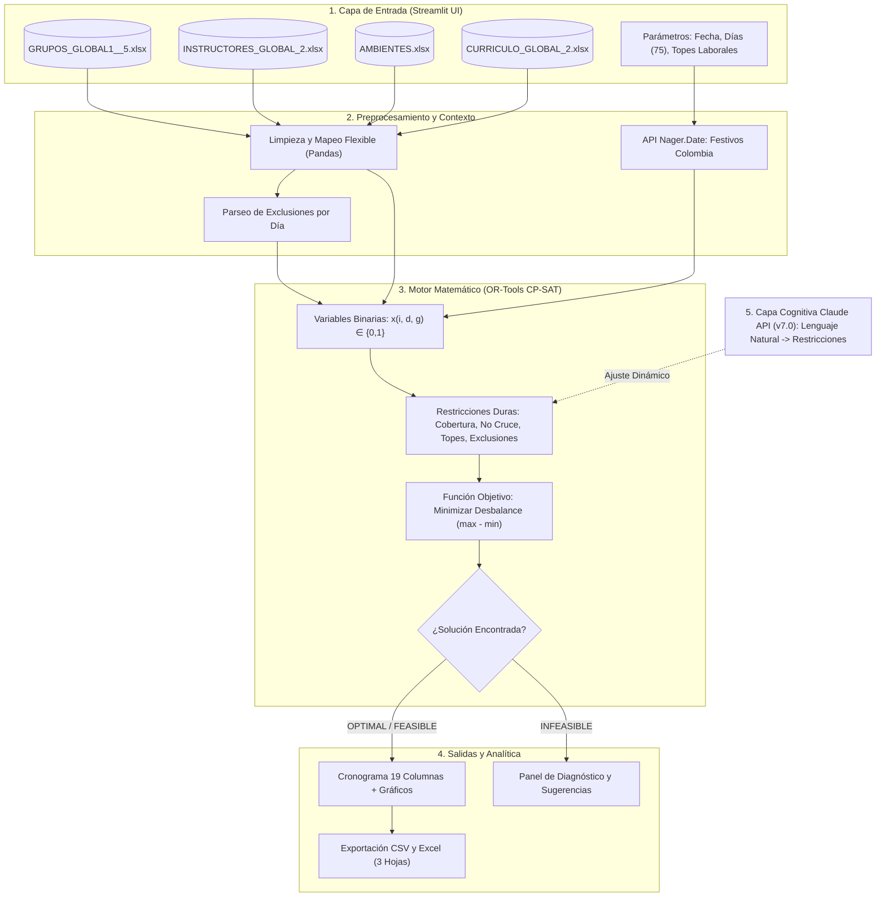
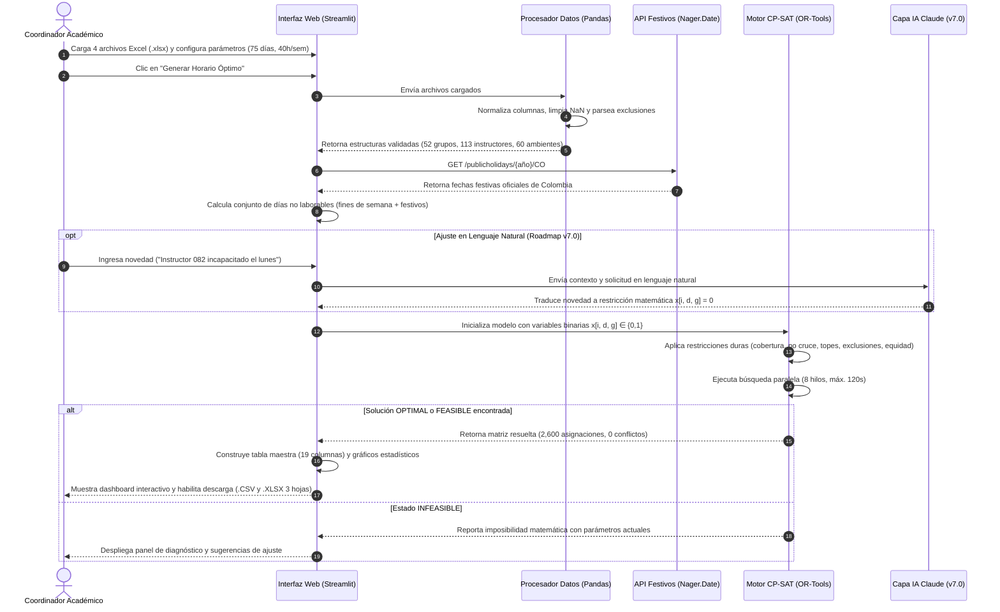
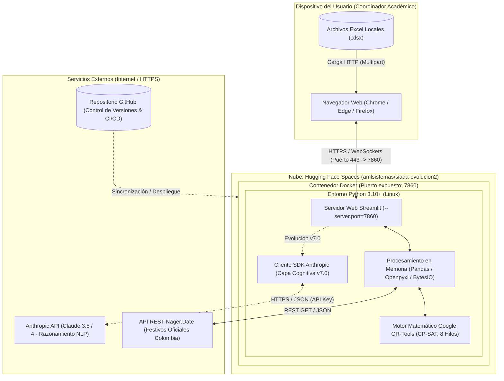

# Arquitectura del Sistema — SIADA+ Evolución v6.1

**Sistema Inteligente de Asignación de Docencia y Ambientes**  
**Autor:** Alejandro Martínez Lopera (Tecnólogo ADSO)  
**Entorno Operativo:** [Hugging Face Spaces (Running)](https://huggingface.co)  

---

## 1. Diagrama Lógico de Flujo y Optimización

Representa el procesamiento interno de datos, la formulación matemática de variables binarias $x_{i,d,g} \in \{0,1\}$, las restricciones duras (`Hard Constraints`) y la proyección cognitiva con Claude.

---

## 2. Diagrama de Secuencia Operativa

Detalla la interacción cronológica entre el Coordinador Académico, la interfaz web, los servicios externos y el solucionador combinatorio de 8 hilos.

---

## 3. Diagrama de Despliegue (Arquitectura Cloud)

Describe la infraestructura contenerizada en **Docker** desplegada en **Hugging Face Spaces** y su comunicación con APIs externas.

